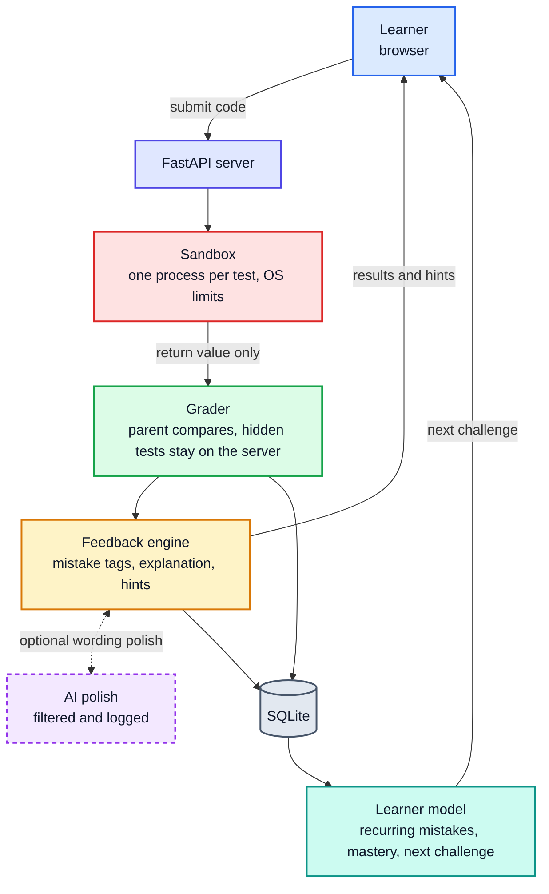

# Drishta / Debug Dojo - Python Practice Platform

**Find the bug. Keep the struggle.**

A Python practice environment that runs learner code in a restricted sandbox, tells the learner *where to look* instead of handing over the answer, and remembers which mistakes they keep making.

**Live demo:** https://tiles-identity-scheme-lands.trycloudflare.com/

> The demo runs from the team's laptop through a temporary Cloudflare tunnel. If the link does not load, the tunnel was restarted; ask the team for the new address.

---

## The idea

Rohan is in his first semester. His `last_k_total` function passes all three of his examples, but the practice site says *Wrong Answer on test 5*, and test 5 is hidden. So he pastes the question into a chatbot, copies the answer and submits. Accepted. Next week the exam has the same kind of loop, and there is no chatbot in the exam hall.

Rohan never needed the answer. He needed someone to point him to the right place, then a little more if he was still stuck, and later a new problem that makes him face the same mistake until he stops making it. Debug Dojo does that loop:

**Observe, investigate, hypothesise, modify, test, learn.**

## How it works



Color key: red is the isolated sandbox, green is the trusted grader, yellow is the feedback engine, purple is the optional AI, teal is the learner model.

Grading and secrecy happen on the server side of the diagram: learner code only ever produces a return value, and everything that decides pass or fail, tags, hints and recommendations is computed outside the sandbox. The dotted path is optional and never affects grading.

## Features

| Area | What it does |
|---|---|
| **Challenges** | 10 challenges across 3 difficulty levels (easy, medium, hard) and several concepts (lists, loops, slicing, strings, conditions, copying, sorting, edge cases). Each has a description, starter code, concept tags, 3 visible tests and 5 or more hidden tests, including edge cases. The four judge challenges (`last-k-total`, `count-passes`, `first-n-squares`, `middle-three`) follow the specification exactly. |
| **Restricted execution** | Learner code never runs in the web server. Every test runs in its own child process with CPU, memory, file-size, process and open-file limits, a wall-clock timeout, a cleared environment, a temporary working directory and capped output. |
| **Per-test outcomes** | Each test is reported separately as exactly one of `passed`, `wrong_output`, `runtime_error` or `timeout`. Runs killed by a memory, output or file limit are runtime errors and name the limit (visible tests only). |
| **Hidden tests stay hidden** | The server compares answers, not the sandbox, so expected values never exist inside learner code. For hidden tests the API returns only the test number and outcome (optionally a plain-words kind such as "an empty list"). Hidden inputs, expected values, program output and exception messages never reach the browser. |
| **Plain-language explanations** | A diagnosis-first explanation: what passed, how the failing tests failed, and one place to look. It names the *kind* of input involved, never values. |
| **Progressive hints** | A ladder of 4 hints per failure, each more specific than the last, with no code in any hint and no "show solution" button. Asking for the answer returns the next hint with a polite refusal. |
| **Recurring mistakes** | Every failed submission is tagged with mistake categories. A category becomes *recurring* only when it appears in at least 2 different challenges, so one-off slips are not flagged. |
| **Skills by concept** | A mastery estimate per concept. A pass with no hints counts for more than a pass after hints; failures lower the estimate. |
| **Next challenge** | The system picks the next challenge to practise a recurring mistake and says why. |
| **Execution trace** | Step-by-step trace of a public example (`POST /api/trace`): lines, variable values and changes, recorded once and replayed without re-running. Hidden tests are never traced. |
| **Optional AI polish** | If an API key is configured, an LLM rewrites the deterministic explanation in friendlier words. The LLM sees only counts and plain-words input kinds, never hidden tests, learner code or answers. It never decides pass/fail, tags or hints. If the provider is missing, slow or returns unsafe text, the app silently uses the deterministic explanation. Every prompt and response is logged to `logs/llm_log.jsonl`. |

## API (for judges)

| Endpoint | Purpose |
|---|---|
| `POST /api/submit` | Body `{learner_id, challenge_id, code}`. Returns `submission_id`, `visible` test results, `hidden` outcomes only, `mistake_tags` and `explanation`. Also includes `deterministic_explanation`, `enhanced_explanation` and `explanation_source` when AI polish is enabled. |
| `POST /api/hint` | Body `{submission_id}`. Returns the next hint on the ladder (`hint`, `level`, `remaining`, `note`). |
| `GET /api/learner/{learner_id}` | Returns recurring mistakes, mastery per concept and the next challenge with its reason. |
| `GET /api/challenges` | Public challenge list (no hidden tests). |
| `POST /api/trace` | Trace of one chosen visible example. |
| `GET /api/ai-status` | Whether AI polish is enabled and its state (never includes keys). |

Example (replace the learner id with any pseudonymous id):

```bash
curl -s -X POST https://tiles-identity-scheme-lands.trycloudflare.com/api/submit \
  -H 'Content-Type: application/json' \
  -d '{"learner_id":"judge_1","challenge_id":"last-k-total","code":"def last_k_total(marks, k):\n    total = 0\n    for i in range(len(marks) - k, len(marks)):\n        total += marks[i]\n    return total\n"}'
```

## Mistake taxonomy and how each is detected

Detection is rule-based and behavioural, not AI. The runner records safe metadata for each test (did it return `None`, did it print, was the input mutated, the error type, the test's kind); the detectors in `dojo/detectors.py` use it together with parent-side comparison of results. A tag is added only when its rule fires.

| Category | Meaning | Detection rule |
|---|---|---|
| `off_by_one` | A loop, slice or range starts or stops one position away from where it should | Wrong output that differs from the expected result by exactly one element or by 1, or failures clustering on boundary-size inputs |
| `unhandled_short_input` | Empty or too-short input is not handled | Failures or crashes on tests whose kind is empty, short or larger-than-list, while ordinary inputs pass |
| `print_not_return` | The function prints the answer instead of returning it | The function returned `None` on failing tests while it printed output |
| `boundary_comparison` | A comparison such as `<` versus `<=` is wrong at the limit | Failures only on tests exactly at the threshold, while the other kinds pass |
| `mutates_input` | The function changes the list it was given | The input after the call differs from a deep copy taken before the call |

A category is **recurring** once it appears in at least 2 different challenges. Several failures in the same challenge do not count.

## Security design

- **Child process per test**, with OS resource limits (`resource.setrlimit`): CPU time, memory, file size, process count, open files. If the limits cannot be applied (for example on native Windows), the runner refuses to run learner code instead of running it unrestricted.
- **Parent-side grading.** The child only runs the learner's function and returns the value as bounded JSON bytes. The parent compares it with the expected value, so learner code cannot print "passed" or exit its way to a pass, and it cannot see hidden data. The parent never unpickles anything from the child.
- **Restricted imports and file access** inside the child, a cleared environment, and a fresh temporary directory removed after every test.
- **Bounded everything:** message size, captured output, execution time and concurrent submissions.
- **Fail closed:** any internal error becomes a runtime error, never a pass.
- **Frontend escaping:** every API-derived value is escaped before it is placed in the page.

### Known limitations (honest notes)

- Blocking the network is done at the Python import level, not by the operating system. For production, run the whole app in a container with the network disabled for learner code.
- The child process runs as the same operating-system user as the server. Importing and file access are restricted in Python, but a production deployment should drop privileges or use a separate unprivileged user.
- The server must run on Linux (WSL2 on Windows). The AI polish is optional and uses a hosted model.

## Running it

The server runs on Linux. On Windows, use WSL2 (Ubuntu).

```bash
# one-time setup (inside Ubuntu / WSL2)
cd ~/project
python3 -m venv .venv
source .venv/bin/activate
pip install -r requirements.txt   # or: pip install fastapi uvicorn httpx pytest

# start everything (one command)
python run.py
# then open http://localhost:8000
```

### Optional: AI explanation polish

Create a `.env` file (never commit it) next to `run.py`:

```text
OPENROUTER_API_KEY=your-key
OPENROUTER_MODEL=openai/gpt-4o-mini
AI_OUTPUT_ENHANCEMENT=true
```

The variable names are historical. The code talks to an OpenAI-compatible endpoint (currently `https://aicredits.in/v1`, set in `dojo/llm.py`), so any provider with the same request format works. With no key set, the app uses the deterministic explanations and everything else works unchanged. The startup line says whether AI polish is configured.

### Tests

```bash
python -m pytest -q
```

The suite covers outcome labels, hostile programs (infinite loops, memory, output and file floods, fork attempts, forged results, harness tricks, deletion attempts), hidden-test secrecy, mistake detectors, hints, the learner model and frontend escaping. Last full run: 136 passed.

### Putting it online for others

```bash
# terminal 1
python run.py
# terminal 2 (Cloudflare quick tunnel)
cloudflared tunnel --url http://localhost:8000
```

The tunnel prints a public https address. Keep both terminals running.

## Project layout

```text
run.py                 start the app
dojo/api.py            FastAPI routes
dojo/runner.py         sandboxed per-test execution and grading
dojo/detectors.py      mistake tagging
dojo/explanations.py   diagnosis-first explanations
dojo/hints.py          code-free hint ladders
dojo/learner.py        mastery and recommendations
dojo/tracing.py        public-example execution trace
dojo/llm.py            optional AI explanation polish
challenges/            10 challenge definitions with visible and hidden tests
frontend/              single-page browser UI
tests/                 automated tests
```

## Data and privacy

Learner accounts are pseudonymous ids typed by the user. No real student data is collected. The database lives in `data/` and the AI log in `logs/`; both are excluded from version control.

## Credits

Challenges, hidden tests, hints and explanations were written by the team. Built for a 24-hour hackathon.

## `Made By Shubhh :D`
